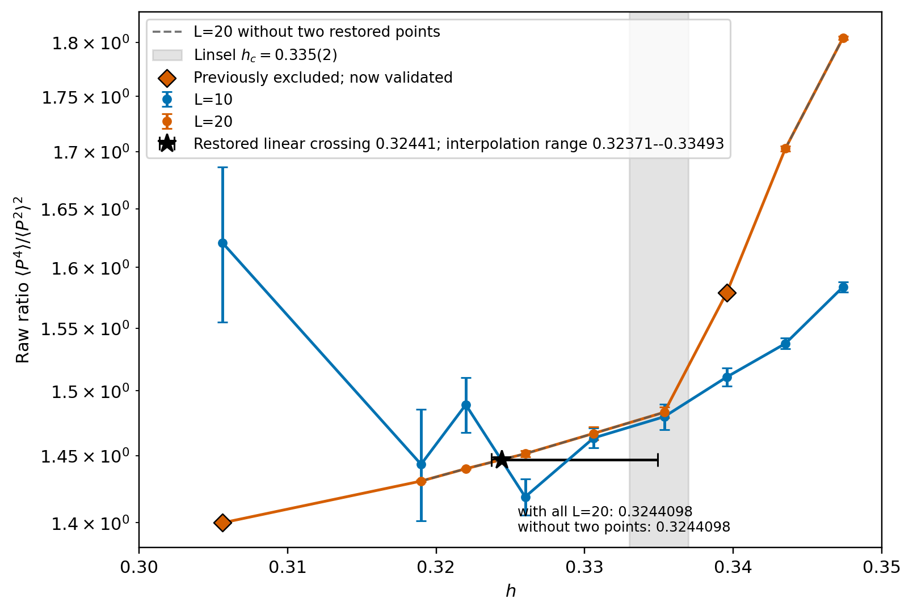

# ParaToric Benchmark Report — reproducing a published result

Purpose: the campaign's ANCHOR. A concrete, external, published number that our
code + settings must reproduce, so that any peer (or future agent) can check in
one minute that we are doing physics and not chasing an artifact. Come back here
whenever a result looks strange: if this benchmark still passes, the machinery is
sound and the strangeness is elsewhere.

Status: 2026-07-23. PROVISIONAL; the clean-window audit leaves the exact-size
L=10/L=20 crossing undefined, so the benchmark is not closed (see 5). Update on
each new result.

--------------------------------------------------------------------------------
## 1. The benchmark source (the paper)

Linsel, Bohrdt, Homeier, Pollet, Grusdt,
**"Percolation as a confinement order parameter in Z2 lattice gauge theories"**,
Phys. Rev. B **110**, L241101 (2024) — arXiv:**2401.08770**.
Specifically their **Fig. 4a** (QMC of the extended toric code).

Why this paper: it is the SAME model and the SAME observable family as ParaToric
(the percolation-inspired order parameters our code implements), run in the SAME
regime (quantum, T=1/L). It is the only published anchor in our own units.

--------------------------------------------------------------------------------
## 2. What we must reproduce (CONCRETE numbers we expect)

Setting (must match exactly):
- Model: extended toric code, **mu = J = 1**
- Basis: z; Boost lattice; periodic square
- **beta = L** (their T = 1/L)
- **lmbda = 0.3 FIXED**, scan **h** across the transition
  (NOTE: this is the ISING line — deliberately OFF the self-dual line.
   The transition here is CONTINUOUS 3D Ising, NOT the first-order MCP.)
- Observable: **Binder cumulant of the (plaquette) percolation strength**
- Their sizes: L = 10, 20, 30

Expected values:
| quantity | Linsel value |
|---|---|
| critical field | **h_c = 0.335(2)** |
| correlation-length exponent | **nu = 0.65(27)**  (3D Ising) |
| universality | 3D Ising (continuous) |

Note on nu: Linsel's own error is +/-0.27 (~40%). Do NOT demand a tight nu from
L<=32 — nobody gets one. The benchmark's job is **h_c location + Ising
compatibility**, not a precise nu.

--------------------------------------------------------------------------------
## 3. Our setup

Current anchor: L=10 and L=20, beta=L, lmbda=0.3, mu=J=1, z-basis, no PT,
plaquette percolation strength on rotated imaginary-time slices, eight independent
chains (four cold plus four hot) per h. These are two of Linsel's three exact
sizes. Job `15149119` ran to 40M sweeps at L=10; job `15159599` ran to 64M at
L=20, both sampled every 25 sweeps.

Analysis uses only stationary suffixes: after 16M sweeps at L=10; after 8M at
L=20, except h=0.318989179906 after its validated 48M plateau entry. L=20
h=0.305629247317 and h=0.339573841268 are restored: the corrected blocking audit
gives cold/hot z=0.3283/0.4188 and suffix p=0.3280/0.2021. Tau remains unresolved
at h=0.339573841268 (blocking lower bound >=2157.001764 sweeps), but the mean and
its bootstrap error pass the validity gates. L=30 has not run. A finite-L L=10/L=20
crossing is not Linsel's extrapolated h_c.
Trend first, number second.

--------------------------------------------------------------------------------
## 4. The path: intermediate results -> fixes -> current result

Binder-cumulant crossings (pairwise, L=20/24/28). Spread = max-min across pairs.

| stage | crossings | spread | status |
|---|---|---|---|
| A. PT, broken mechanism, uniform ladder | drifts, no convergence | — | NO-GO |
| B. PT, mechanism FIXED, uniform dh=0.025 | 0.350(1) / 0.331(1) / 0.327(1) | 0.023 | NO-GO |
| C. PT, mechanism fixed + ladder RESOURCED | **0.3406 – 0.3437** | **0.003** | PROVISIONAL |
| D. Exact-size no-PT L=10/L=20, all nine points, before the per-chain gate | **linear 0.3244097798; interpolation range 0.3237135711--0.3349290674** | **0.0112154963** | SUPERSEDED: contaminated L=10 points |
| E. Exact-size no-PT L=10/L=20, per-chain-spread gated | **no data-bracketed crossing at spread gates <0.10, <0.05, or <0.03** | **undefined** | PROVISIONAL / NOT ANCHORED |
| target (Linsel) | **0.335(2)** | — | — |

**The two fixes (short):**
1. **Swap-partner bug.** Partner was chosen by MPI *rank* while the ladder label
   *migrates* on accept => adjacent ranks held non-adjacent ladder positions =>
   the ladder severed => 0 round-trips. Fix: choose the partner by **ladder
   position** via MPI_Allgather (`rank_of_ladder_index[i+/-1]`), ported from
   `code_ruby_duy_pinning_lab/worm.update.cpp`. Details: pt_architecture.md sec 7.
2. **Ladder under-resourcing.** Acceptance is set by energy-distribution overlap:
   sigma ~ dh*sqrt(Var E) ~ dh*L^(3/2), so a fixed dh dies as L grows (L28: 14/14
   links dead). Fix: **N_rungs ~ L^(3/2)**, non-uniform, denser near h_c
   (N = 40/48/60 for L = 20/24/28). Details: pt_architecture.md sec 8.
   Calibration measured the exponent as **1.69** (vs 1.5 from pure volume; the
   excess is the specific-heat enhancement L^(alpha/nu) near h_c) — use 1.69.

Stage C's PT crossing spread collapsed 0.023 -> 0.003 after the two mechanism
fixes, but it was not promoted. Stage D restored both formerly excluded L=20
points, but its local linear crossing is bracketed by h=0.322--0.326. The
per-chain audit subsequently showed that the L=10 endpoint at h=0.322 fails even
the loosest pre-committed spread gate. Stage E therefore supersedes Stage D:
there is no measured clean-window crossing to which an interpolation uncertainty
can honestly be attached.

--------------------------------------------------------------------------------
## 5. Current result and HONEST status

Curve errors below are hierarchical chain/block-bootstrap standard errors from
1,000 resamples (seed 20260720). Both formerly excluded L=20 means are restored;
their ratio means and errors were never invalidated by the tau-estimator defect.
The table is retained as source evidence, not as permission to cross contaminated
L=10 points.

| h | L=10 raw ratio +/- bootstrap error | L=20 raw ratio +/- bootstrap error |
|---:|---:|---:|
| 0.305629247317 | 1.620594488 +/- 0.065789675 | **1.399854822 +/- 0.000403214** |
| 0.318989179906 | 1.443357268 +/- 0.041930118 | 1.430742096 +/- 0.000596750 |
| 0.322000000000 | 1.489079406 +/- 0.021437993 | 1.440026145 +/- 0.000346187 |
| 0.326000000000 | 1.418993177 +/- 0.013435356 | 1.451363556 +/- 0.002472915 |
| 0.330615254621 | 1.463439077 +/- 0.007419584 | 1.466906462 +/- 0.005133156 |
| 0.335362847648 | 1.479757821 +/- 0.009856900 | 1.483203689 +/- 0.004081748 |
| 0.339573841268 | 1.510839219 +/- 0.006959165 | **1.579050185 +/- 0.002549444** |
| 0.343520981103 | 1.537532272 +/- 0.004333580 | 1.702697467 +/- 0.002274703 |
| 0.347398758564 | 1.583705271 +/- 0.004110110 | 1.804171955 +/- 0.001492930 |

The earlier with/without-L=20 comparison is retained for provenance only:

| L=20 treatment | local linear crossing | bootstrap statistical error | interpolation range | full spread |
|---|---:|---:|---:|---:|
| all nine points | **0.3244097798** | 0.0008659348 | **0.3237135711--0.3349290674** | **0.0112154963** |
| omit h=0.305629247317 and 0.339573841268 | **0.3244097798** | 0.0008649342 | **0.3237135711--0.3349354739** | **0.0112219028** |

The systematic scan uses 18 choices: linear, PCHIP, natural cubic, and unweighted
degree-1/2/3 polynomial curves over all points, a window dropping only the lowest
h, and the central six points. Natural cubic interpolation has multiple roots;
all are retained. On the contaminated full window this produced
0.3237135711--0.3349290674, width 0.0112154963; that range is now superseded, not
a current crossing uncertainty.

The old source TSV actually records 0.3244097798 +/- 0.0008170099. The
0.0000817 value repeated in narrative updates was a decimal-place transcription
error; neither statistical bar is publishable as the total uncertainty.

The spread thresholds were pre-committed before looking at proximity to Linsel's
0.335(2); they were not tuned. Strict `<` is used. Gate membership comes from
the ratified per-chain spread audit in `doc/feynman_thesis_tojarvis.md` UPDATE
2026-07-20j; curve means come from the current source TSV:

| max per-chain spread gate | jointly passing h data (both sizes) | clean-window crossing | 18-choice in-window scan |
|---:|---|---|---|
| <0.10 | 0.326000000000--0.347398758564 (6 points) | **NONE**: L=10 minus L=20 is negative at all 6 measured points | 8/18 choices create higher-order overshoot roots; conditional all-root range 0.3286115324--0.3354936738, width 0.0068821414; 10/18 have no root |
| <0.05 (default) | 0.339573841268--0.347398758564 (3 points) | **NONE**: no sign change | 0/18 choices have a root; envelope undefined |
| <0.03 | h=0.347398758564 only (1 point) | **NONE**: not estimable from one point | 18-choice scan structurally unavailable; envelope undefined |

Thus the old 0.0112154963 envelope does **not** collapse into a clean result; the
crossing itself disappears when contaminated low-h points are excluded. The
numerically narrower `<0.10` conditional root span is not an uncertainty envelope:
linear and shape-preserving PCHIP have no root, and every measured clean point has
the same sign. Quoting one of the overshoot roots would be model extrapolation
between non-bracketing data.

**Window-convention check.** Reproducing the ratified spread values requires the
L=10 per-chain audit's 400000-sample discard, whereas the crossing curve above
uses its validated 632000-sample stationary-suffix discard. Recomputing spreads
on that same 632000-sample suffix leaves the `<0.10` field set unchanged, tightens
`<0.05` to h=0.343520981103--0.347398758564, and leaves no point at `<0.03`.
Every retained difference still has the same sign, so the no-crossing verdict is
unchanged; the primary threshold table follows the ratified audit as directed.

**Status remains PROVISIONAL.** The earlier statement that `0.3244097798` was
"consistent within honest systematics" is superseded because it was read from
contaminated L=10 points. This pass does not promote benchmark closure, establish
a dynamical exponent, or say anything about the MCP. L=30 remains unrun.

--------------------------------------------------------------------------------
## 6. The anchor plot

**Current exact-size figure:**
- x: h; y: raw ratio <P^4>/<P^2>^2 of plaquette percolation strength on a log
  scale, matching Linsel Fig. 4a's convention;
- L=10 and the restored nine-point L=20 curve with bootstrap error bars;
- both formerly excluded L=20 points marked as validated, with the old omitted
  curve shown dashed for direct comparison;
- the coincident with/without linear crossings, the full interpolation envelope,
  and Linsel's 0.335(2) band.

CURRENT PLOT PATH: `doc/figures/linsel_raw_ratio_crossing_no_pt_l10_l20_restored_20260721.png`

CURRENT TABLE PATH: `doc/figures/linsel_no_pt_l10_l20_restored_diagnostics_20260721.tsv`

**The L=10 baseline is not ergodic at low h: its per-chain spread is up to 150x
larger than L=20 at the same h.**

| Superseded full-window crossing (shown for provenance) | Per-chain disagreement and PT repair |
|---|---|
|  |  |

CHAIN-DISAGREEMENT PLOT PATH:
`doc/figures/l10_chain_disagreement_and_pt_repair_20260721.png`

ENTRYPOINT: registered `scripts/ensemble_diagnostics.py no-pt-benchmark`, seeded
with `20260720`; inputs are jobs `15149119` and `15159599` under their scratch
roots stated in sec. 3.

PRIOR PT RAW-RATIO PLOT (retained): `doc/figures/linsel_raw_ratio_crossings_pt_resourced_20260716.png`

SUPERSEDED U PLOT (retained): `doc/figures/linsel_binder_crossings_pt_resourced_20260716.png`

--------------------------------------------------------------------------------
## 7. How to re-check / what would change the verdict

- The two former L=20 void points are now cleared and restored. Re-run the
  registered `no-pt-benchmark` mode with the same seed, suffix rules, and
  `--sensitivity-exclude` pair to reproduce both curves and the interpolation
  envelope retained for historical provenance. Then apply the pre-committed
  per-chain spread gates and restrict every root search to the jointly passing
  fields to reproduce the clean-window table in sec. 5.
- Promotion requires a clean second-size curve that restores an in-window,
  data-bracketed crossing; no interpolation choice can substitute for that.
- Before adding L=30, repair or replace the non-ergodic L=10 baseline and repeat
  the same per-chain gate. The observable remains statically calibrated
  (doc/paratoric_run_manual.md G5).

--------------------------------------------------------------------------------
## 8. COMPANION VALIDATION — the self-dual line (NOT the benchmark line)

**Read the header of this section before using anything in it.** The result below is
on the **SELF-DUAL line (h = lmbda = s)**, which is a DIFFERENT LINE from this
report's benchmark (**lmbda = 0.30 FIXED**, scan h). It is recorded here because it
is the strongest INSTRUMENT VALIDATION we have, and this report is where we come to
ask "is the machinery sound?". It is **not** a benchmark result and must never be
quoted as one. The two critical points are numerically close and that closeness is a
known trap:
  - benchmark critical point: (h, lmbda) = (0.335, **0.30**)   — off-diagonal
  - self-dual MCP:            (s*, s*)   with s* ~ 0.33         — on the diagonal
Same h to two digits, different lmbda. See `doc/multicritical_universality_plan.md`
M1 for the s* deliverable itself; this section records only what it says about the
INSTRUMENT.

FIGURE: `doc/figures/selfdual_sstar_crossing_duality_20260723.png`
DATA: `/scratch/a/A.Otaifi/paratoric_selfdual_step2a_20260721/` (job `15177203`)

### What it validates
1. **Duality (I2/B5) passes on the self-dual line with the CORRECT channel pairing.**
   At L=16, `z-plaquette` vs `x-direct` percolation PROBABILITY (run manual A8:
   z-plaq == x-perc), z-scores 0.4 / 2.1 / 1.6 / 0.3 / 1.0 across s = 0.250-0.375.
   The WRONG pairing (z-plaq vs x-plaq, same graph) is off by a factor ~40
   (0.7416 vs 0.0184 at s=0.300). So the observable, the basis mapping, the
   rotated-slice measurement and the duality bookkeeping are all confirmed
   simultaneously, on a line where duality is an exact symmetry and therefore an
   exact test. **This is a stronger instrument check than the benchmark itself
   provides**, because it is a symmetry statement rather than a comparison to a
   published number.
2. **It passes even where the raw-ratio observable is dead.** Above s ~ 0.35 the
   percolation strength is 81-98% exact zeros, so `<P^4>/<P^2>^2` divides two
   vanishing moments and is meaningless there (spreads of 8.5, 167, 418 on a
   quantity of order 1.5). The BOUNDED probability channel keeps working and keeps
   satisfying duality. This is the harness's own >50%-exact-zeros tripwire, now
   wired into an automated gate (OBSERVABLE-DEGENERATE) rather than left on paper.

### Consequence for THIS report
The plaquette PROBABILITY channel is now the validated instrument of record for
LOCATION and duality (as the run manual A8 already specified). Where the raw ratio is
used for the Linsel overlay it must be accompanied by its zero-fraction; on the
benchmark line the zero fraction is 0.23-0.40, comfortably below the tripwire, so the
benchmark overlay is NOT affected by the degeneracy above. That was checked, not
assumed.

### What this section does NOT do
It does not close, promote, or weaken the benchmark. Sec 5 remains PROVISIONAL and
the outstanding blocker is unchanged: there is currently **no usable clean-window
L=10/L=20 crossing**, because L=10 is not ergodic at low h
(`doc/figures/l10_chain_disagreement_and_pt_repair_20260721.png`). A duality pass on
a different line is instrument evidence; it is not a reproduction of Linsel Fig. 4a.
